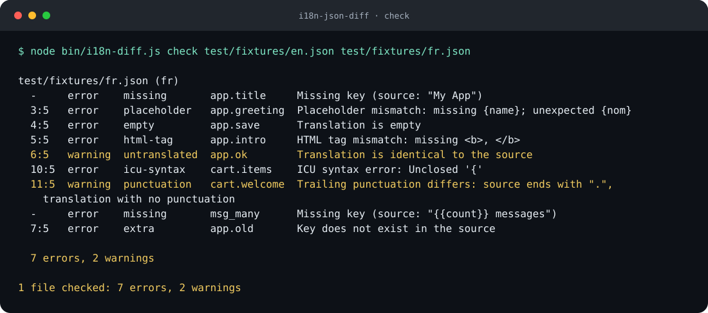

# i18n-json-diff

[](https://github.com/YusufBeratZengin/i18n-json-diff/actions/workflows/ci.yml) [](LICENSE) [](https://nodejs.org/) [](package.json) [](https://www.npmjs.com/package/i18n-json-diff)

Çeviri JSON dosyalarındaki hataları bulur ve tamamlanan çevirileri mevcut biçimlendirmeyi koruyarak birleştirir.

[English](README.md) | Türkçe



## Neden?

- Eksik anahtarların yanında hatalı mesajları da yakalar: yer tutucuları, ICU sözdizimini, HTML etiketlerini ve `Intl.PluralRules` ile her dilin gerektirdiği çoğul kategorilerini denetler.
- Çeviri incelemelerini sade tutar: özgün JSON metnini yerinde güncelleyerek girintiyi, satır sonlarını ve mevcut çevirileri korur.
- Çalışma zamanı bağımlılığı olmadan yerel çalışır: iç içe ve düz JSON, Node.js >=20; düz metin, JSON, Markdown veya GitHub Actions çıktısı.

## Hızlı başlangıç

Depoyu klonlayıp örnek dosyalarla deneyin; CLI için kurulum gerekmez:

```sh
git clone https://github.com/YusufBeratZengin/i18n-json-diff.git
cd i18n-json-diff
node bin/i18n-diff.js check test/fixtures/en.json test/fixtures/ru.json
node bin/i18n-diff.js check test/fixtures/en.json test/fixtures/fr.json
```

Rusça örnek kontrolden geçer (çıkış `0`). Fransızca örnek bilerek hatalıdır (çıkış `1`); gerçek çıktısı aşağıdadır.

Kendi projenizde kullanmak için paket npm'de yayımlandığında kurabilirsiniz:

```sh
npm install --save-dev i18n-json-diff
# ya da tek seferlik
npx --package i18n-json-diff i18n-diff check locales/en.json 'locales/*.json'
```

GitHub'daki güncel sürümü kurmak için:
`npm install --save-dev github:YusufBeratZengin/i18n-json-diff`.

Komutun adı `i18n-diff`.

## Demo

```sh
node bin/i18n-diff.js check test/fixtures/en.json test/fixtures/fr.json
```

```text
test/fixtures/fr.json (fr)
  -     error    missing       app.title     Missing key (source: "My App")
  3:5   error    placeholder   app.greeting  Placeholder mismatch: missing {name}; unexpected {nom}
  4:5   error    empty         app.save      Translation is empty
  5:5   error    html-tag      app.intro     HTML tag mismatch: missing <b>, </b>
  6:5   warning  untranslated  app.ok        Translation is identical to the source
  10:5  error    icu-syntax    cart.items    ICU syntax error: Unclosed '{'
  11:5  warning  punctuation   cart.welcome  Trailing punctuation differs: source ends with ".", translation with no punctuation
  -     error    missing       msg_many      Missing key (source: "{{count}} messages")
  7:5   error    extra         app.old       Key does not exist in the source

  7 errors, 2 warnings

1 file checked: 7 errors, 2 warnings
```

Çevirmen için iş akışı:

```sh
# 1. eksikleri kaynak metinle birlikte küçük bir JSON dosyasına yaz
i18n-diff export-missing locales/en.json locales/fr.json -o todo-fr.json

# 2. todo-fr.json içindeki değerleri çevir

# 3. geri ekle; yeni anahtarlar mevcut üyelerin önüne gelirse diff yalnızca ekleme gösterir
i18n-diff merge locales/fr.json todo-fr.json --source locales/en.json

# 4. doğrula
i18n-diff check locales/en.json locales/fr.json
```

## Komutlar

### `check <kaynak> <hedef...>`

Her hedefi kaynakla karşılaştırır ve sorunları yazar. Hata varsa çıkış kodu `1`, yoksa `0`.

| Seçenek | Anlamı |
|---|---|
| `--format text\|json\|github\|markdown` | Çıktı biçimi. `markdown`, PR yorumuna uygun dosya, anahtar, kontrol ve mesaj tablosu üretir. `github`, iş akışı komutları yazar (`::error file=...`); eksik anahtarlar dosya başına tek bildirimde toplanır. |
| `--max-issues <sayı>` | Markdown satır sınırı (varsayılan: 200). Kalan sorun sayısı `... and N more` satırında belirtilir; çıkış kodu tüm sorunları hesaba katar. |
| `--ignore a,b` | Bu kontrolleri atla (aşağıdaki tabloya bakın). |
| `--warnings-as-errors` | Uyarılarda da `1` ile çık. |
| `--allow-key <desen>` | Kaynakla aynı kalabilecek anahtar. `*` ve `?` joker karakterdir. Tekrarlanabilir. |
| `--allow-value <metin>` | Kaynakla aynı kalabilecek değer (marka adı, `OK`). Tekrarlanabilir. |
| `--locale <etiket>` | Hedeflerin dili. Varsayılan olarak dosya adından (`fr.json`, `pt_BR.json`, `messages.de.json`) ya da üst klasörden (`ja/common.json`) bulunur. |
| `--source-locale <etiket>` | Kaynağın dili, aynı yöntemle bulunur. |
| `--config <dosya>` | Ayar dosyası. Varsayılan: çalışma klasöründe varsa `.i18n-diff.json`. |

Hedef dosya adında `*` veya `?` kullanılabilir (joker karakteri açmayan Windows kabuklarında işe yarar). Kaynak dosyanın kendisi eşleşirse atlanır.

### `export-missing <kaynak> <hedef>`

Çevirisi gereken anahtarları, değer olarak kaynak metinle ve kaynak sırasıyla küçük bir JSON'a yazar. Hedef dosya henüz yoksa da çalışır (yeni dil).

| Seçenek | Anlamı |
|---|---|
| `-o, --output <dosya>` | Çıktıyı ekrana değil dosyaya yaz. |
| `--only-missing` | Var ama boş olan anahtarları dışarıda bırak. |
| `--include-untranslated` | Değeri kaynakla aynı olan anahtarları da listele. |
| `--shape auto\|nested\|flat` | Çıktının biçimi. `auto` kaynak dosyayı izler. |

Hedef dilin ihtiyaç duyduğu ama kaynakta olmayan çoğul biçimleri (örneğin Rusça için `item_few`) kaynağın `_other` metniyle gelir.

### `merge <hedef> <doldurulmuş>`

`doldurulmuş` dosyadaki (iç içe ya da düz) çevirileri `hedef` dosyaya ekler.

- Yeni anahtarlar kaynak sırasına göre doğru yere konur. `--source <dosya>` verilirse sıra kaynaktan, verilmezse doldurulmuş dosyadan alınır.
- Girinti (boşluk ya da sekme), satır sonu (LF ya da CRLF), eksik son satır sonu ve BOM korunur. Mevcut satırlar yeniden biçimlendirilmez; yeni anahtarlar mevcut üyelerin önüne eklendiğinde `git diff` yalnızca eklenen satırları gösterir.
- Anahtar bir nesnenin son kaydından sonra gelecekse o satıra virgül eklenir.
- Hedefteki boş değerler (`""` ya da `null`) yerinde doldurulur. Dolu çevirilere `--overwrite` verilmedikçe dokunulmaz.
- `--source` ile kaynakta olmayan anahtarlar atlanır (bilinen çoğul gruplarının biçimleri kabul edilir).
- Hedef dosya yoksa oluşturulur.

| Seçenek | Anlamı |
|---|---|
| `--source <dosya>` | Kaynak dosya: anahtar sırasını belirler, bilinmeyen anahtarları reddeder. |
| `--overwrite` | Dolu çevirilerin üzerine de yaz. |
| `--dry-run` | Ne değişeceğini yaz, hiçbir şey kaydetme. |
| `-o, --output <dosya>` | Sonucu başka bir dosyaya yaz. |

### `stats <kaynak> <hedef...>`

Dosya başına tamamlanma oranı.

```sh
node bin/i18n-diff.js stats test/fixtures/en.json test/fixtures/fr.json test/fixtures/ru.json
```

```text
File                   Locale  Translated  Missing  Empty  Untranslated  Extra  Complete
test/fixtures/fr.json  fr      9/12        2        1      1             1      75.0%
test/fixtures/ru.json  ru      13/13       0        0      0             0      100.0%
```

| Seçenek | Anlamı |
|---|---|
| `--format text\|json\|markdown` | Tamamlanma verisini terminal tablosu, JSON veya PR yorum tablosu olarak yaz. |
| `--sort completion` | En düşük tamamlanma oranı önce gelir; eşitlikte dosya adına göre sıralanır. Varsayılan: girdi sırası. |
| `--min <yüzde>` | Bir dosya bu eşiğin (0–100) altındaysa `1` ile çık. Ayarlardaki tüm eşiklerin yerine geçer. |

Ayar dosyasında `minCompletion` ile dile özel eşik ve `default` yedek değeri tanımlanabilir. Tamamlanma, boş olmayan çevirileri sayar; kaynakla aynı kalan metinler ayrı uyarı olarak gösterilir ve tamamlanmaya dahildir.

## Kontroller

| Kontrol | Önem | Ne bulur |
|---|---|---|
| `missing` | hata | Kaynaktaki anahtar hedefte yok. |
| `extra` | hata | Hedefteki anahtar kaynakta yok. |
| `empty` | hata | Çeviri `""`, boşluk ya da `null`. |
| `placeholder` | hata | Yer tutucu kümesi kaynaktan farklı: `{name}`, `{{name}}`, `$t(key)`, `@:key` ve ICU plural/select dalları içindeki argümanlar. Sıra önemsizdir. |
| `icu-syntax` | hata | Çeviri geçerli ICU MessageFormat değil (kapanmamış parantez, eksik `other` dalı, hatalı seçici ...). Kaynağın kendisi ayrışmıyorsa raporlanmaz. |
| `html-tag` | hata | Etiketler kaynaktan farklı (`<b>`, `</b>`, `<br/>`, `<0>`). Öznitelikler yok sayılır; yerelleştirilmiş `href` sorun değildir. |
| `duplicate-key` | hata | Aynı anahtar, kaynakta veya hedefte aynı nesne içinde birden çok kez tanımlanmış. |
| `key-collision` | hata | Kaynakta veya hedefte farklı yollar aynı noktalı anahtara dönüşüyor. |
| `invalid-file` | hata | Hedef geçerli bir JSON nesnesi değil. |
| `untranslated` | uyarı | Değer kaynakla aynı. İki dilin ana dili aynıysa (`en` ve `en-GB`), değerde harf yoksa ve izin listesindeki anahtar ya da değerlerde atlanır. |
| `punctuation` | uyarı | Sondaki noktalama sınıfı farklı (`.`, `!`, `?`, `:`, `;`, `,`, `...`). Tam genişlikli, Arapça ve Devanagari işaretler ASCII karşılığı sayılır. |

### Çoğul biçimler

`item_one` / `item_other` gibi anahtarlar, kaynakta `_other` biçimi ve en az bir başka biçim varsa çoğul grubu sayılır. Hedefte o dilin ihtiyaç duyduğu kategoriler beklenir; bunlar `Intl.PluralRules`'tan gelir (Rusça: `one`, `few`, `many`, `other`; Japonca: `other`). Dil, dosya adından ya da `--locale`'den alınır; bulunamazsa kaynağın biçimleri beklenir. Sıra sayısı grupları (`key_ordinal_one`) ordinal kuralları kullanır. Çoğul biçimlerde `_other` biçimine göre yer tutucu eksik olabilir ("bir öğe" gibi), ama bilinmeyen yer tutucu yine raporlanır.

## Yapılandırma

`.i18n-diff.json` (tüm alanlar isteğe bağlı):

```json
{
  "ignore": ["punctuation"],
  "allowKeys": ["brand.*", "*.url"],
  "allowValues": ["OK", "Email"],
  "sourceLocale": "en",
  "warningsAsErrors": false,
  "format": "text",
  "minCompletion": { "default": 90, "de": 100 }
}
```

Komut satırı seçenekleri, ayar dosyasındaki listelere eklenir.

| Alan | Tür / davranış |
|---|---|
| `ignore`, `allowKeys`, `allowValues` | Metin dizileri; CLI listeleri bunlara eklenir. |
| `sourceLocale` | `en` gibi bir metin. |
| `warningsAsErrors` | Boolean; varsayılan `false`. |
| `format` | Check çıktısı: `text` (varsayılan), `json`, `github`, `markdown`. |
| `minCompletion` | Dil etiketlerini sayısal yüzdelere (0–100) eşleyen nesne. Önce tam dil eşleşmesi, sonra `default` kullanılır; ikisi de yoksa eşik uygulanmaz. CLI `--min` tüm haritanın yerine geçer. |

Bilinmeyen alanlar ve geçersiz türler girdi hatasıdır. `stats`, ayarlardaki check biçiminden bağımsız olarak `--format` kullanır.

## Kullanım örnekleri

Sentetik İngilizce, Fransızca, Almanca ve Rusça dosyalar, gerçek komut çıktıları ve CI örneği için [çalıştırılabilir çevirmen projesine](examples/README.md) bakın.

## GitHub Actions

```yaml
- uses: actions/setup-node@v4
  with:
    node-version: 22
- run: npx --package i18n-json-diff i18n-diff check locales/en.json 'locales/*.json' --format github
```

## Kütüphane olarak kullanım

```js
import { compareFiles, loadLocaleFile, mergeTranslations } from 'i18n-json-diff';

const source = loadLocaleFile('locales/en.json');
const target = loadLocaleFile('locales/fr.json');
const { issues, summary } = compareFiles(source, target);
```

Diğer dışa aktarımlar: `parseLocaleText`, `exportMissing`, `parseIcu`, `analyze`, `extractTags`, `detectLocale`, `loadConfig`, `CHECKS`.

## Çıkış kodları

| Kod | Anlamı |
|---|---|
| 0 | Hata yok (`--warnings-as-errors` ile uyarı da yok; `--min` üstünde). |
| 1 | Sorun bulundu. |
| 2 | Kullanım hatası, okunamayan ya da geçersiz kaynak/doldurulmuş dosya, hatalı ayar. |

## Nasıl çalışır?

Konum bilgisi tutan JSON ayrıştırıcısı, her değerin özgün metindeki aralığını saklar. Kontroller düzleştirilmiş anahtar haritasını karşılaştırır; merge yalnızca yeni üyeleri ekler veya değişen değerleri yerinde günceller. Girinti, satır sonları, BOM ve mevcut metin korunur. Sona üye eklemek önceki son satıra virgül ekler; boş değer doldurmak veya üzerine yazmak ilgili satırı değiştirir.

## Sık sorulanlar / Sınırlar

**Demo neden 1 çıkış koduyla bitiyor?** Örnek dosyada bilerek hatalı çeviriler var. İhtiyaç duymadığınız kontrolleri `--ignore` ile atlayabilir, uyarıların da CI'ı durdurmasını `--warnings-as-errors` ile sağlayabilirsiniz.

**Marka adları çevrilmeden kalabilir mi?** Evet. Ayarlara `allowKeys` veya `allowValues` ekleyin ya da `--allow-key` / `--allow-value` kullanın.

**Mesajları otomatik çeviriyor mu?** Hayır. `export-missing` kaynak metinleri çeviri için hazırlar; `merge` tamamlanmış çevirileri dosyaya ekler.

**Hangi biçimler ve özel durumlar destekleniyor?**

- Yalnızca JSON. YAML, `.po`, `.properties` ve JSON5 desteklenmez. İlk yorum (`//` veya `/*`) ya da sondaki virgül, satır ve sütunuyla hedefte `invalid-file` sorunu üretir; geçersiz kaynak dosyası `InputError` fırlatır. Metin değerlerinin içindeki yorum işaretleri serbesttir.
- ICU desteği sözdizimini ve argüman adlarını kapsar, biçimlendirmeyi değil. Bilinmeyen argüman türleri sözdizimi hatası sayılır.
- Diziler indeksleriyle düzleştirilir (`list.0`). Anahtardaki nokta kaçırılmaz: `{"a.b":"x"}` ve `{"a":{"b":"x"}}`, `a.b` olur. Ayrı dosyalarda bu yazımlar eşleşir. Aynı dosyada birlikte bulunurlarsa `key-collision` raporlanır; haritada son ziyaret edilen yaprak değeri kalır. Export veya merge öncesi çakışmaları giderin.
- Tekrarlanan anahtarlar bulundukları nesneye göre değerlendirilir: `a.x` ve `b.x` farklıdır; `a` içinde tekrarlanan `x`, `duplicate-key` üretir. Tekrarlanan nesne anahtarları da raporlanır. Aynı yaprak yolunda son ziyaret edilen değer kalır; tekrarlanan nesnelerin önceki alt yolları haritada kalabilir. Export veya merge öncesi tekrarları giderin.
- Dosyalar yerel işlenir; CLI ağ isteği yapmaz ve çeviri verisini dış servislere göndermez.
- Noktalama ve "çevrilmemiş" kontrolleri sezgiseldir; bu yüzden uyarıdır.

## Geliştirme

```sh
npm ci
npm run lint
npm test
npm run demo
npm run bench
npm pack --dry-run
```

`npm test`, Node'un yerleşik satır, dal ve fonksiyon kapsam raporunu terminalde ve CI'da gösterir. Proje sade JavaScript kullanır; ayrı bir typecheck komutu yoktur, kaynak kod ESLint ile denetlenir. CI, Windows ve Linux üzerinde Node 20, 22 ve 24 ile çalışır. Benchmark bellekte 20.000 anahtar üretir; ayrıştırma/check ve merge sürelerini ölçer.

`npm run demo`, yukarıdaki komutu CLI giriş noktası üzerinden çalıştırarak `docs/demo.svg` görselini yeniden üretir. CI, güncelliğini `node scripts/make-demo.mjs --check` ile doğrular. Tam çıktı Demo bölümünde metin olarak da bulunur.

## Katkı

[CONTRIBUTING.md](CONTRIBUTING.md) dosyasına bakın. Güvenlik sorunları için: [SECURITY.md](SECURITY.md).

## Lisans

[MIT](LICENSE) (c) 2026 Yusuf Berat Zengin
